# Arquitectura de Ingeniería — TEPUI // Gran Sabana Sonic Lab & Reference VST/CLAP Stack

Este documento detalla las decisiones arquitectónicas, las garantías de seguridad en tiempo real (*real-time audio safety*), el flujo de señal DSP, el sistema de diseño industrial **Flush Architectural Grid (`@audio-ui/react`)** y las **7 Compuertas de Certificación UI↔DSP** que convierten a **TEPUI** en un instrumento de nivel estudio y en un stack plantilla open-source para plugins de audio en Rust.

---

## 1. Principios de Diseño en Tiempo Real (Real-Time Audio Safety)

El callback de procesamiento de audio (`TepuiPlugin::process()`) opera bajo restricciones deterministas estrictas (bloques de `64` a `512` muestras a `44.1 kHz` – `192 kHz`, equivalentes a `< 1.3 ms` por bloque). Para impedir *dropouts*, *xruns* o inversión de prioridad:

1. **Cero Asignaciones Dinámicas en el Hilo de Audio (`assert_process_allocs`)**:
   - Todas las estructuras del camino crítico (`VoiceManager`, `Voice`, `HermiteResampler`, `SvfFilter`, `AdsrEnvelope`, `LfoEngine`, `ArpEngine`, `StereoFxRack` y buffers de trabajo) se prealocan durante `Plugin::initialize()` o `Default::default()`.
   - Cuando el hilo de síntesis (`AiWorker`) entrega un nuevo `Arc<SampleBuffer>`, el buffer saliente se envía por una cola acotada (`garbage_tx`) hacia un hilo recolector de fondo para que `drop()` jamás se ejecute dentro del hilo de audio en tiempo real.
2. **Sincronización Lock-Free (< 15 ns) y Lectura Consistente (`SeqLock`)**:
   - Todos los parámetros continuos, modos discretos, máscara de la matriz `5×5` y pesos bipolares por celda (`mod_matrix_weights: [AtomicU32; 25]`) residen en [`LiveParamStore`](crates/plugin_vst/src/params.rs) mediante variables atómicas (`AtomicU32` / `AtomicI32` con `Ordering::Relaxed`).
   - Al inicio de cada bloque de audio, [`LiveParamStore::project_to_dsp`](crates/plugin_vst/src/params.rs) proyecta el estado atómico hacia `VoiceManager` y `StereoFxRack` en una sola pasada sin bloqueos.
   - La telemetría de dominio operativo (`OddTelemetry`) utiliza un protocolo **SeqLock** sin bloqueos para publicar métricas de RMS, pitch detectado, voces activas y contadores de eventos hacia la interfaz a `60 FPS`.
3. **Grabación Master No Bloqueante (`LiveMasterRecorder`)**:
   - Prealoca `720,000` frames estéreo al iniciar el plugin y utiliza `Mutex::try_lock()` desde el callback de audio: si el hilo de UI está serializando el archivo `.wav`, el hilo de audio jamás espera.

---

## 2. Topología Completa de la Cadena de Señal DSP (`crates/synth_core/`)

```mermaid
flowchart TD
    A["Entrada MIDI Sample-Accurate + Armonizador (#btn-chord-mode)\n(NoteOn/Off, CHORD:MIN7/MAJ9/STRUM, PitchBend, CC#1, CC#64, CC#74, Aftertouch, MPE)"] --> B["ArpEngine Polifónico (12 / 16 Pasos)\n(Off / Up / Down / Joropo 6/8 / Merengue 5/8\n+ Carriles VEL / RATCH 1x..4x / OCT ±1 + Exportador .mid SMF)"]
    B --> C["Ruteador Tri-Zone & Micro-Afinación (.scl)\n(12-TET / Just 5-Limit / Arpa Llanera / Maqam / Custom .scl)"]
    C --> D["Banco Polifónico de 16 Voces × Super-Unison (1..8V)\n• OSC A: Hermite 4-Point + 2x Oversampling + Wavetable 3D (64×32)\n• 4 Modos Spectral Warp (Fold / Asym / Sync / Quant)\n• OSC B + Sub -1 Oct + FM Cruzada A←B + Nube Granular 4-Grain Hann"]
    D --> E["9 Topologías de Filtrado Por Voz (filter.rs)\n• 0..3: Cytomic SVF ZDF (LP / HP / BP / Bypass)\n• 4: Moog Ladder 24dB • 5: Karplus-Strong Comb • 6: Formant Vocal A-E-I-O-U\n• 7: Dual Serie (HP 2-Pole → Ladder LP 24dB)\n• 8: Dual Paralelo (SVF LP ‖ Formant 3-Band)"]
    E --> F["Doble Envolvente ADSR (Curva Exp/Lin/Log + Legato)\n+ Matriz de Modulación 5×5 con Atenuversores Bipolares (-100%..+100%)"]
    F --> G["StereoFxRack Master (fx.rs)\n• Drive Analógico + Compresor Multibanda OTT 3-Band\n• 4 Modos Espaciales: FX:CANYON / FX:PHASER / FX:TAPE / FX:DELAY (Ping-Pong Sync)"]
    G --> H["Master Gain + Soft Clipper Analógico + Sanitizador IEEE 754\n+ Analizador FFT 64 Bandas + LiveMasterRecorder (.wav 32-bit Float)"]
```

---

## 3. Síntesis en Silicio Local (`< 1 ms`) y Modelado Físico (`crates/ai_bridge/`)

1. **Síntesis Instantánea de Wavetables en Silicio Local ([`synthesize_local_silicon_wavetable`](crates/ai_bridge/src/npu_synth.rs))**:
   - Genera en `< 1 ms` y sin conexión de red un ciclo base de 64 muestras alineado en fase (`[f32; 64]`) más una tabla morfable completa de 32 frames (`2048` muestras) a partir de descriptores en lenguaje natural (`acid`, `reese`, `choir`, `arpa`, `bell`, etc.).
2. **Modelado Físico Venezolano y Hub Multi-Proveedor IA**:
   - Modela físicamente **Cuatro Venezolano**, **Arpa Llanera**, **Bandola Llanera**, **Maracas Capachos**, **Tambor Cumaco**, **Quitiplás de Barlovento** y **Furruco Zuliano**, además de conectarse opcionalmente a **Cloudflare Community Edge KV**, **Ollama Local**, **Google Gemini**, **Groq Cloud LPU** u **OpenAI / OpenRouter**.

---

## 4. Sistema de Diseño Industrial: Flush Architectural Grid (`crates/plugin_vst/ui/`)

- **Primitivas `@audio-ui/react`**: Construido sobre componentes accesibles y deterministas (`Knob`, `Fader`, `Plot`, `Envelope`, `StepSequencer`, `XYPad`, `Meter`, `Piano`) en [`crates/plugin_vst/ui/src/components/`](crates/plugin_vst/ui/src/components/).
- **Retícula Continua de `1px` y Contención Estricta (`1280 × 820 px`)**: Sin sub-cajas anidadas ni sombras redundantes, verificando automáticamente `overflowCount = 0` y `truncatedTitles = 0` en las **6 skins de hardware** (`skin-minimal`, `skin-dark`, `skin-retro`, `skin-synth70`, `skin-gunmetal`, `skin-phosphor`).
- **Las 7 Compuertas de Certificación UI↔DSP ([`ui_dsp_contract.rs`](crates/plugin_vst/src/ui_dsp_contract.rs))**: Garantizan en tiempo de test que cada elemento del DOM tenga un contrato IPC válido y produzca un impacto medible en la señal de audio DSP.
