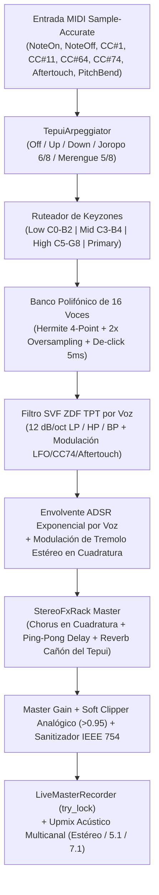

# Arquitectura de Ingeniería — TEPUI Neural Chromatic Sampler

Este documento describe las decisiones arquitectónicas, las garantías de tiempo real (*real-time safety*), el flujo de señal DSP y los mecanismos de comunicación entre hilos que componen **TEPUI // Gran Sabana Sonic Lab**.

---

## 1. Principios de Diseño en Tiempo Real (Real-Time Audio Safety)

El callback de procesamiento de audio (`AiSamplerPlugin::process()`) opera bajo restricciones estrictas de latencia determinista (típicamente bloques de `64` a `512` muestras a `44.1 kHz` – `192 kHz`, equivalentes a `< 1.3 ms` por bloque). Para evitar *dropouts*, *xruns* o inversión de prioridad:

1. **Cero Asignaciones Dinámicas en el Hilo de Audio (`assert_process_allocs`)**:
   - Todas las estructuras del camino crítico (`VoiceManager`, `Voice`, `HermiteResampler`, `SvfFilter`, `AdsrEnvelope`, `LfoEngine`, `TepuiArpeggiator`, `StereoFxRack` y el buffer auxiliar mono) se prealocan durante `Plugin::initialize()` o `Default::default()`.
   - La característica `assert_process_allocs` de `nih_plug` intercepta el asignador global en compilaciones de depuración/prueba y aborta inmediatamente si ocurre cualquier `alloc` o `dealloc` dentro de `process()`.
2. **Sincronización Lock-Free y Contención Cero**:
   - Los parámetros continuos y discretos se comparten entre el hilo de audio, el host DAW y el editor WebView2 a través de [`LiveParamStore`](crates/plugin_vst/src/params.rs), utilizando exclusivamente variables atómicas (`AtomicU32` con conversión binaria `f32::to_bits()` / `f32::from_bits()` y `AtomicI32` con `Ordering::Relaxed`).
   - Los eventos discretos de baja latencia (teclado virtual/QWERTY `GuiMidiEvent` y cambios de parámetros `WebGuiEvent`) viajan por colas acotadas prealocadas (`crossbeam_channel::bounded`) drenadas con `try_recv()`.
   - La grabadora Master en vivo (`LiveMasterRecorder`) prealoca `720,000` frames estéreo al iniciar el plugin y emplea `Mutex::try_lock()` desde el hilo de audio: si el hilo de interfaz está exportando el archivo WAV, el callback de audio jamás espera ni se bloquea.

---

## 2. Topología de la Cadena de Señal DSP (`crates/synth_core`)

### 2.1 Resampling Hermite con Centinelas y 2x Oversampling
- Cada [`SampleBuffer`](crates/synth_core/src/buffer.rs) añade automáticamente **2 muestras centinela en cero (`0.0`)** al final de los vectores `left` y `right`.
- Esto permite que [`HermiteResampler`](crates/synth_core/src/resampler.rs) lea siempre los 4 puntos adyacentes (`y0, y1, y2, y3`) sin comprobaciones condicionales de límites dentro del bucle por muestra.
- Cuando la transposición cromática supera `1.25x` (+4 semitonos), el motor evalúa dos sub-pasos Hermite a mitad de intervalo y los promedia mediante un filtro de media móvil de fase lineal, mitigando el *aliasing* por plegamiento espectral en registros altos.

### 2.2 Filtro SVF Zero-Delay Feedback (TPT)
- Implementado en [`filter.rs`](crates/synth_core/src/filter.rs) siguiendo la formulación trapezoidal de Vadim Zavalishin.
- Los coeficientes `g` y `k` se recalculan únicamente cuando cambia la frecuencia de corte efectiva (modulada por el LFO, `CC#74` o `Aftertouch`) o la resonancia, evitando llamadas trigonométricas `tan()` redundantes en cada muestra.
- Los integradores de estado (`ic1eq`, `ic2eq`) purgan valores subnormales (`|x| < 1e-15`) a `0.0` en cada iteración para evitar penalizaciones de microcódigo en CPUs x86_64.

### 2.3 Reverberación Algorítmica "Cañón del Tepui" (`StereoFxRack`)
- Implementada en [`fx.rs`](crates/synth_core/src/fx.rs), combina:
  1. **Chorus Estéreo en Cuadratura** (`0.65 Hz`, desfase de `90°` entre L y R con interpolación lineal fraccional).
  2. **Ping-Pong Cross-Delay** (`330 ms` L / `460 ms` R) con filtro pasa-bajos de absorción atmosférica en el lazo de retroalimentación.
  3. **Tanque de Reverberación "Cañón del Tepui"**: 4 filtros Comb en paralelo con amortiguación (`damping = 0.28`, `feedback = 0.84`) seguidos de 2 difusores All-Pass en serie por canal, escalados dinámicamente hasta tasas de muestreo superiores a `192 kHz` sin reasignar memoria.

---

## 3. Síntesis y Modelado Físico Venezolano (`crates/ai_bridge`)

El crate [`ai_bridge`](crates/ai_bridge/src/lib.rs) ejecuta un hilo trabajador en segundo plano (`AiWorker`) para que la síntesis de muestras nunca afecte al hilo de audio:

- **Modelado Físico de Cuerdas Venezolanas**:
  - **Cuatro Venezolano (`C4`)**: Síntesis de cuerda pulsada de nylon con formantes de caja de cedro y golpe de charrasqueo.
  - **Arpa Llanera (`C4`)**: Serie armónica cristalina con inharmonicidad ligera y ataque de uña/yema.
  - **Bandola Llanera (`A3`)**: Ataque percusivo de pajuela (*jalao*) y énfasis en el 2.º, 3.º y 5.º armónico de su caja periforme.
- **Modelado Físico de Percusión y Sub-Bajos Venezolanos**:
  - **Maracas Llaneras / Capachos (`C4`)**: Doble golpe granular de semillas de capacho con resonancias huecas de tapara (`1.48 kHz` y `3.12 kHz`).
  - **Tambor Cumaco (`C3`)**: Modos circulares de membrana de cuero (funciones de Bessel `1.00`, `1.593`, `2.136`) con caída de tono al impacto + golpe agudo de *laures* (palos sobre madera).
  - **Quitiplás de Barlovento (`C4`)**: Tubos cilíndricos de bambú (*Pujao* y *Prima*) con modos impares y transitorio de entrechoque a los `42 ms`.
  - **Furruco Zuliano Sub (`C2`)**: Excitación *stick-slip* de verada encerada acoplada a un resonador sub-grave sostenible con bucle activo.

---

## 4. Interfaz WebView2 Serverless y Persistencia (`crates/plugin_vst`)

- **Protocolo Personalizado `tepui://localhost/`**:
  - En lugar de abrir sockets TCP locales (propensos a bloqueos por firewall o colisiones de puerto cuando se instancian múltiples pistas del plugin en un DAW), [`web_editor.rs`](crates/plugin_vst/src/web_editor.rs) registra el esquema en memoria `tepui://` directamente en WebView2.
- **Formato de Patch `.tepui`**:
  - [`TepuiPatch`](crates/plugin_vst/src/params.rs) encapsula en un único archivo JSON autocontenido la muestra principal en WAV IEEE Float 32-bit Base64, las 3 Keyzones (`LOW`, `MID`, `HIGH`) en Base64 y todos los parámetros del motor (`ADSR`, `SVF`, `LFO`, `ArpMode`, `SpaceMix`, `Region/Loop`).
