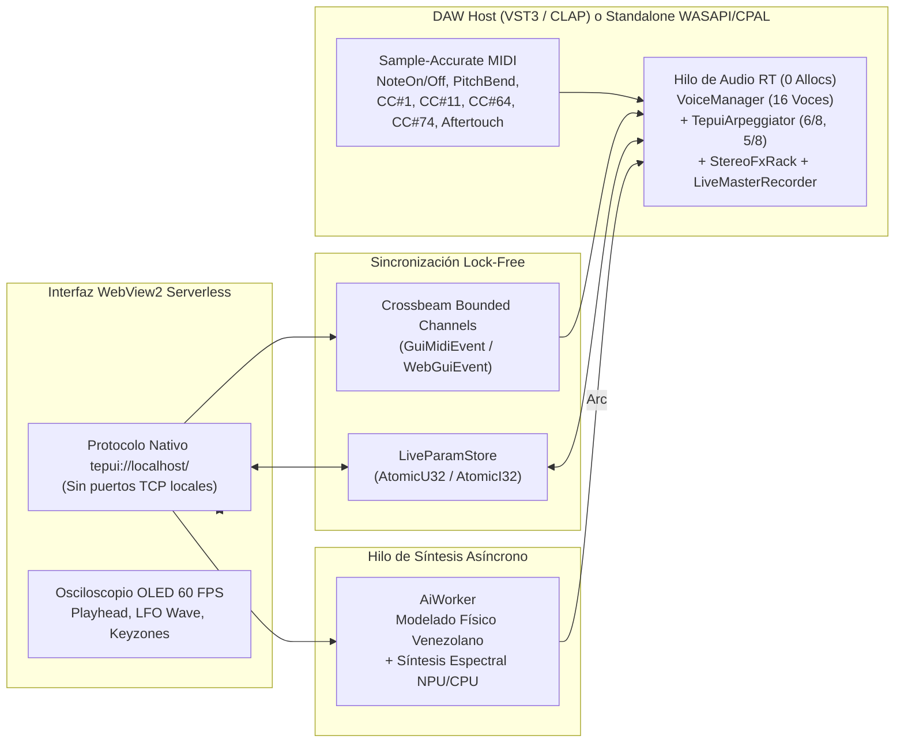

<p align="center">
  
</p>

<h1 align="center">
  &nbsp;TEPUI // Gran Sabana Sonic Lab
</h1>

<p align="center">
  <a href="https://github.com/davidcastilloc/tepui-vst/actions/workflows/ci.yml"></a>
  <a href="https://github.com/davidcastilloc/tepui-vst/actions/workflows/release.yml"></a>
  <a href="https://www.rust-lang.org/"></a>
  <a href="#compilación-e-instalación"></a>
  <a href="LICENSE"></a>
</p>

**TEPUI** es un sintetizador y sampler cromático polifónico de 16 voces desarrollado íntegramente en **Rust**, disponible como plugin **VST3**, **CLAP** y estación de trabajo **Standalone (`tepui_studio.exe`)** para Windows x64.

Combina un motor DSP de tiempo real libre de asignaciones dinámicas (*zero-allocation audio thread*) con modelado físico de instrumentos acústicos venezolanos (**Cuatro Venezolano**, **Arpa Llanera**, **Bandola Llanera**, **Maracas Capachos**, **Tambor Cumaco**, **Quitiplás de Barlovento**, **Furruco Zuliano**) y síntesis espectral acelerada por hardware.

---

## Arquitectura del Sistema



---

## Características Técnicas

| Subsistema | Especificación de Ingeniería |
| :--- | :--- |
| **Motor Polifónico (`synth_core`)** | 16 voces simultáneas con robo inteligente de voces (*voice stealing*) y rampa lineal de anti-click (`5 ms` crossfade). |
| **Interpolación Cromática** | Resampling polinomial **Hermite de 4 puntos (4-Point 3rd-Order)** con **2x Oversampling** en transposiciones agudas (`pitch_ratio > 1.25`) y centinelas de memoria para cero ramificaciones en el bucle interno. |
| **Filtrado por Voz** | Filtro de Variable de Estado **Zero-Delay Feedback (ZDF) Topology-Preserving Transform (TPT)** de 12 dB/octava (`Lowpass`, `Highpass`, `Bandpass`, `Bypass`) con protección IEEE 754 contra números subnormales. |
| **Modulación y Expresión MIDI** | LFO global sincronizado (`Cutoff`, `Pitch Vibrato`, `Quadrature Stereo Tremolo`), `Pitch Bend` (`±2` semitonos), `Sustain Pedal (CC#64)`, `ModWheel (CC#1)`, `Brightness (CC#74 / CC#11)` y `Aftertouch`. |
| **Arpegiador y Compases Venezolanos** | `TepuiArpeggiator` en pila (`0` asignaciones en tiempo real) con modos `Up`, `Down`, **Joropo Llanero (`6/8`)** y **Merengue Venezolano (`5/8`)** sincronizados al tempo del DAW. |
| **Rack Espacial Master (`StereoFxRack`)** | Chorus Estéreo Analógico en Cuadratura + Ping-Pong Cross-Delay con filtro de amortiguación + **Reverberación Algorítmica "Cañón del Tepui"** (4 filtros Comb en paralelo + 2 difusores All-Pass en serie por canal). |
| **Keyzones Multi-Muestra y `.tepui`** | División del teclado en 3 registros (`LOW C0–B2`, `MID C3–B4`, `HIGH C5–G8`) con persistencia completa en archivos `.tepui` (JSON + WAV IEEE Float 32-bit Base64) y en la sesión del proyecto DAW. |
| **Grabadora Master en Vivo** | Captura `LIVE REC -> WAV` post-FX con buffers estéreo prealocados (`try_lock` no bloqueante en el hilo de audio) y exportación directa a WAV IEEE Float de 32 bits. |

---

## Estructura del Workspace

```text
tepui-vst/
├── crates/
│   ├── synth_core/     # Motor DSP puro en tiempo real (Voces, Hermite, SVF ZDF, ADSR, LFO, Arp, FX, WAV)
│   ├── ai_bridge/      # Hilo trabajador asíncrono, modelado físico venezolano y síntesis espectral
│   ├── plugin_vst/     # Plugin NIH-plug (VST3/CLAP), Host Standalone WASAPI/MIDI y Editor WebView2
│   └── xtask/          # Herramienta de construcción, empaquetado VST3/CLAP, instalador y versionado
├── .github/workflows/  # Pipelines de Integración Continua (CI) y Semantic Release automatizado
├── ARCHITECTURE.md     # Diseño detallado del motor de tiempo real y contratos de concurrencia
├── CHANGELOG.md        # Registro histórico de versiones gestionado con Semantic Release
└── CONTRIBUTING.md     # Guía de contribución, estándares de código y Conventional Commits
```

---

## Requisitos Previos

- **Sistema Operativo**: Windows 10 / 11 (x64) con Microsoft Edge WebView2 Runtime instalado.
- **Toolchain**: Rust Stable (`>= 1.78`, edición 2021) con target `x86_64-pc-windows-msvc`.

---

## Compilación e Instalación

### 1. Verificar Linter y Suite de Pruebas
```powershell
cargo clippy --workspace --all-targets --no-deps -- -D warnings
cargo test --workspace
```

### 2. Compilar e Instalar Bundles Release (`VST3`, `CLAP` y `Standalone`)
```powershell
cargo build --release -p plugin_vst --bins
cargo run --package xtask -- bundle plugin_vst --release
cargo run --package xtask -- install
```

El comando `xtask install` genera y despliega automáticamente:
- **Plugin VST3**: `C:\Program Files\Common Files\VST3\TEPUI.vst3` (con fallback automático sin privilegios de administrador en `%LOCALAPPDATA%\Programs\Common\VST3\TEPUI.vst3`).
- **Plugin CLAP**: `C:\Program Files\Common Files\CLAP\TEPUI.clap` (fallback en `%LOCALAPPDATA%\Programs\Common\CLAP\TEPUI.clap`).
- **Estación Standalone**: `%LOCALAPPDATA%\Programs\Tepui\tepui_studio.exe`.

---

## Versionado y Lanzamientos (Semantic Release)

Este repositorio utiliza **Conventional Commits** y **Semantic Release** (`.releaserc.json` + `.github/workflows/release.yml`) para automatizar el control de versiones semántico (`SemVer`), la actualización de [`CHANGELOG.md`](CHANGELOG.md) y la publicación de artefactos compilados (`TEPUI-GranSabana-Windows-x64.zip`) en cada integración hacia la rama `main`.

---

## Licencia

Distribuido bajo la licencia **MIT**. Consulta el archivo [`LICENSE`](LICENSE) para más detalles.
