<p align="center">
  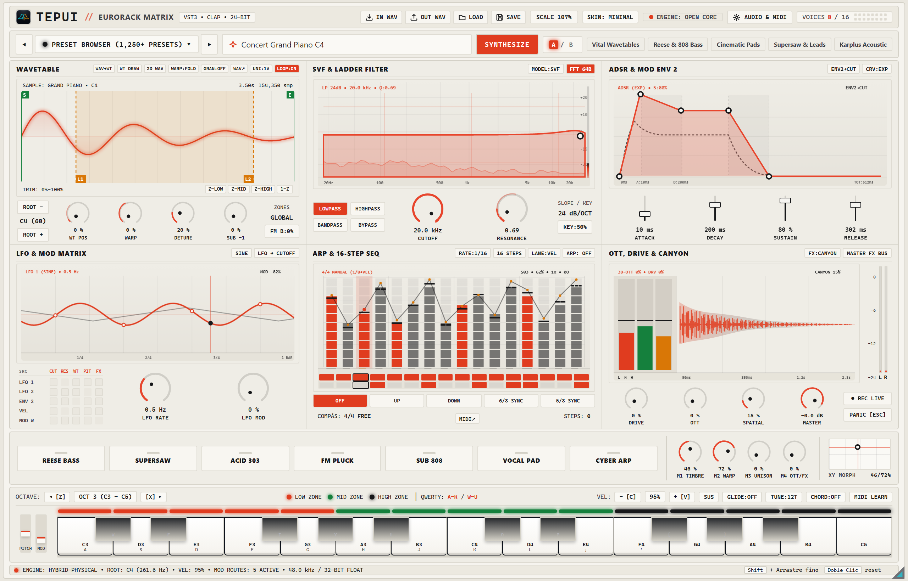
</p>

<h1 align="center">
  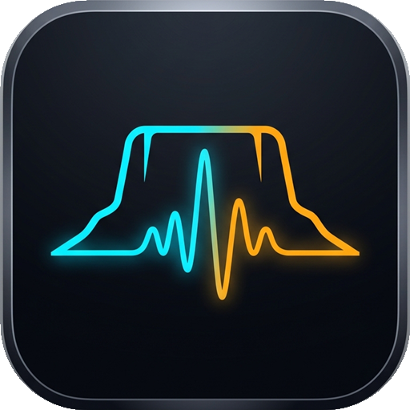&nbsp;TEPUI // Gran Sabana Sonic Lab
</h1>

<p align="center">
  <strong>Sintetizador Polifónico de 16 Voces (Wavetable 3D • Granular • Modelado Físico • Síntesis Espectral NPU) &amp; Stack Plantilla Open-Source para Instrumentos VST3 / CLAP / Standalone en Rust + React (<code>@audio-ui/react</code>)</strong>
</p>

<p align="center">
  <a href="https://github.com/davidcastilloc/tepui-vst/actions/workflows/ci.yml"></a>
  <a href="https://github.com/davidcastilloc/tepui-vst/actions/workflows/release.yml"></a>
  <a href="https://github.com/davidcastilloc/tepui-vst/releases/latest"></a>
  <a href="https://www.rust-lang.org/"></a>
  <a href="#galería-visual--sistema-de-6-skins-de-hardware-audio-uireact"></a>
  <a href="#descarga-directa- e-instalación-rápida"></a>
  <a href="LICENSE"></a>
</p>

<p align="center">
  <a href="https://tepui-vst.pages.dev"><strong>Sitio Web Oficial</strong></a> ·
  <a href="https://github.com/davidcastilloc/tepui-vst/releases/latest"><strong>Descargar Instaladores (Windows / macOS / Linux)</strong></a> ·
  <a href="#plantilla-open-source-cómo-crear-tu-propio-vst3--clap-con-este-stack"><strong>Guía de Uso como Stack Plantilla</strong></a> ·
  <a href="#las-7-compuertas-de-certificación-uidsp-ui_dsp_contractrs"><strong>Contrato de Certificación UI↔DSP</strong></a> ·
  <a href="ARCHITECTURE.md"><strong>Arquitectura Detallada</strong></a>
</p>

---

## Propósito Doble del Proyecto

1. **Instrumento de Producción Musical de Nivel Estudio (`TEPUI`)**:
   Un sintetizador híbrido y workstation cromática de **16 voces** escrita en **Rust**, disponible como plugin **VST3**, **CLAP** (certificado con `clap-validator` oficial en cada commit) y aplicación **Standalone (`tepui_studio`)** para **Windows x64**, **macOS** y **Linux x64**. Combina síntesis Wavetable 3D con 4 modos de *Spectral Warp*, nube granular de 4 granos Hann, 9 topologías de filtrado (incluyendo doble filtro en serie y paralelo), micro-afinación `.scl`, armonizador de acordes y rasgueo llanero, secuenciador polirrítmico de 16 pasos con exportación directa `.mid`, modelado físico de instrumentos acústicos venezolanos y síntesis espectral acelerada en silicio local (`< 1 ms`).

2. **Stack Plantilla Open-Source de Referencia para Plugins de Audio Modernos**:
   Diseñado para servir como **arquitectura base y plantilla de ingeniería** para desarrolladores y equipos que buscan construir instrumentos y efectos **VST3 / CLAP / Standalone** con:
   - **Calidad de sonido impecable**: Hilo de audio 100% libre de asignaciones dinámicas (*zero-allocation real-time thread*), filtros ZDF-TPT y Ladder sin retardo de realimentación, interpolación Hermite con 2× oversampling y protección IEEE 754 anti-subnormales.
   - **Diseño visual industrial con criterio estético (*Anti-Slop / Flush Architectural Grid*)**: Interfaz construida sobre primitivas accesibles de [`@audio-ui/react`](crates/plugin_vst/ui/src/components/) con retícula arquitectónica continua de `1px` inspirada en **Dieter Rams (Braun)**, **Teenage Engineering** y **Elektron**, sin bordes redundantes, sin elementos que se salgan de su contenedor (`overflowCount = 0`) y con **6 skins de hardware** intercambiables en caliente.
   - **Verificación matemática de extremo a extremo**: Suite automatizada de **85 pruebas** que certifica que cada botón, potenciómetro, fader y lienzo OLED de la interfaz altera de forma medible el buffer de audio DSP en tiempo real.

---

## Descarga Directa e Instalación Rápida

| Plataforma | Paquete Oficial (`Latest Release`) | Contenido Incluido |
| :--- | :--- | :--- |
| **Windows 10/11 (x64)** | [**`TEPUI-Setup-Windows-x64.exe`**](https://github.com/davidcastilloc/tepui-vst/releases/latest/download/TEPUI-Setup-Windows-x64.exe) | Instalador auto-extraíble 1-clic para `TEPUI.vst3`, `TEPUI.clap` y `tepui_studio.exe` |
| **Windows 10/11 (ZIP)** | [**`TEPUI-GranSabana-Windows-x64.zip`**](https://github.com/davidcastilloc/tepui-vst/releases/latest/download/TEPUI-GranSabana-Windows-x64.zip) | Bundle portable (`TEPUI.vst3`, `TEPUI.clap`, `tepui_studio.exe`) |
| **macOS (Intel / Apple Silicon)** | [**`TEPUI-macOS-Universal.zip`**](https://github.com/davidcastilloc/tepui-vst/releases/latest/download/TEPUI-macOS-Universal.zip) | `TEPUI.vst3`, `TEPUI.clap` y binario `tepui_studio` |
| **Linux (x64)** | [**`TEPUI-Linux-x64.tar.gz`**](https://github.com/davidcastilloc/tepui-vst/releases/latest/download/TEPUI-Linux-x64.tar.gz) | `TEPUI.vst3`, `TEPUI.clap` y binario `tepui_studio` (ALSA/JACK + WebKit2GTK) |

---

## Galería Visual & Sistema de 6 Skins de Hardware (`@audio-ui/react`)

La interfaz de **TEPUI** implementa una **Retícula Arquitectónica Continua (*Flush Architectural Hairline Grid*)** en un lienzo fijo de `1280 × 820 px`. En lugar de apilar tarjetas flotantes con bordes y sombras artificiales, los 6 módulos Eurorack, la cabecera, el dock de comandos, la bahía de pads/macros y el teclado comparten divisores estructurales limpios de `1px` y tipografía técnica tabulada (`tabular-nums`).

<p align="center">
  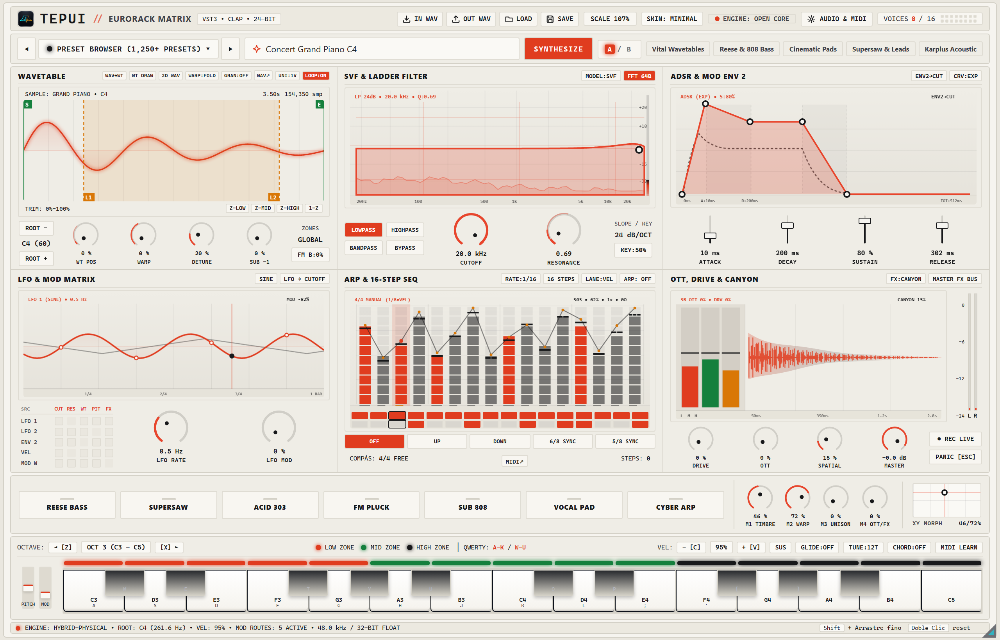
</p>

| **01 // Swiss Daylight Lab (`skin-minimal` • Default)** | **02 // Tepui Dark Studio (`skin-dark`)** |
| :---: | :---: |
|  | 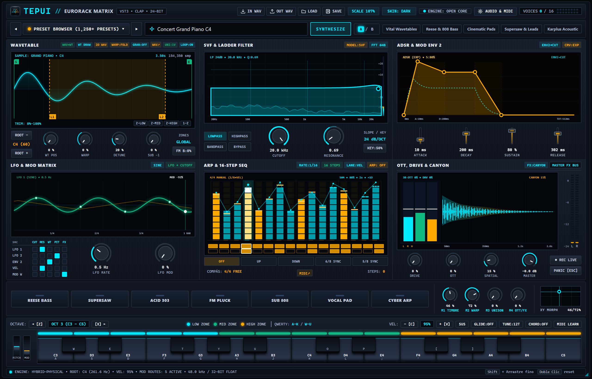 |
| Papel cálido anodizado (`#f6f4ef`), tinta técnica (`#17181a`) y acento Braun (`#e03c1f`). | Chasis oscuro de estudio (`#0b0e13`) con pantallas OLED en cian (`#00f2fe`) y ámbar. |
| **03 // Cream Console (`skin-retro`)** | **04 // Synth '70s (`skin-synth70`)** |
| 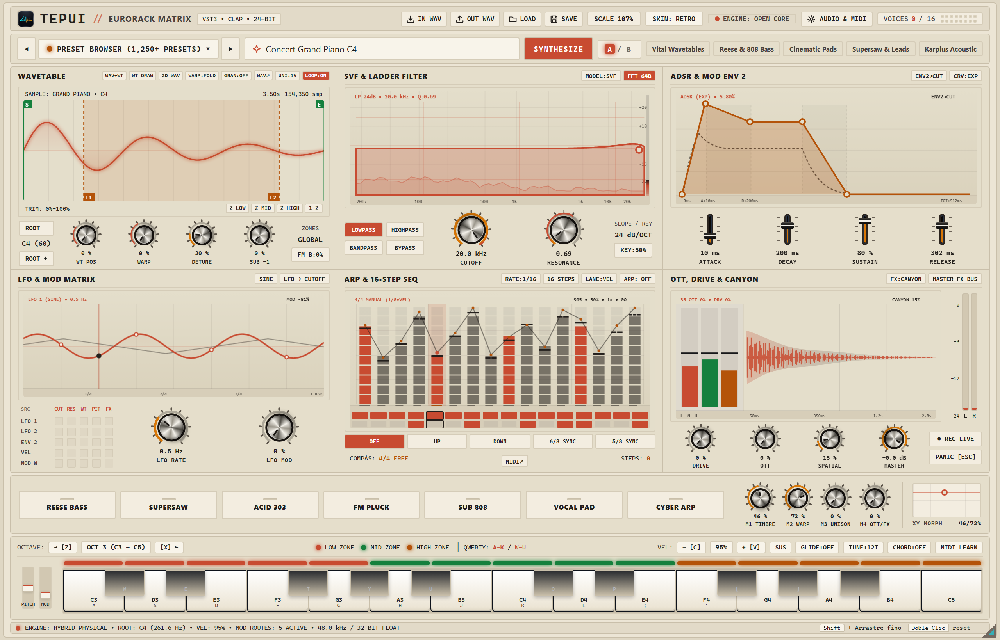 | 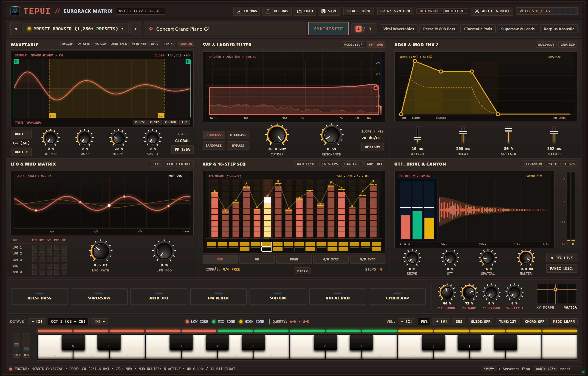 |
| Consola analógica clásica en esmalte crema (`#ece5d5`), diales marfil y terracota (`#c84b31`). | Gabinete cálido años 70 en grafito, crema cálido (`#f4e8c1`) y naranja analógico (`#e06d53`). |
| **05 // Gunmetal Rack (`skin-gunmetal`)** | **06 // CRT Phosphor (`skin-phosphor`)** |
| 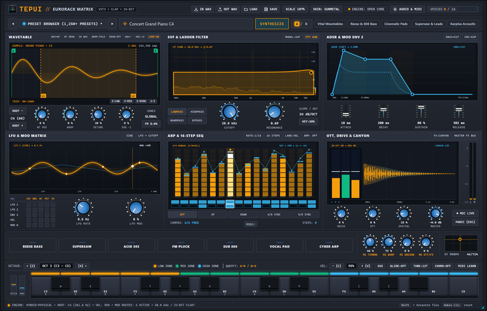 | 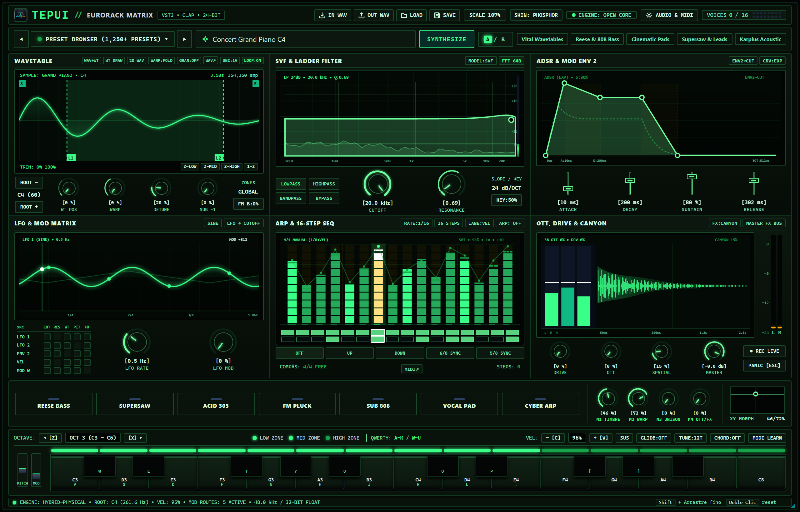 |
| Aluminio anodizado gris acero (`#1e2229`) con indicadores ámbar (`#f59e0b`). | Osciloscopio de laboratorio con fósforo verde P1 (`#39ff88`) sobre negro profundo. |
| **Explorador de 1,250+ Presets & Sound Packs** | **Motor de Apariencia & Selector de Skins** |
| 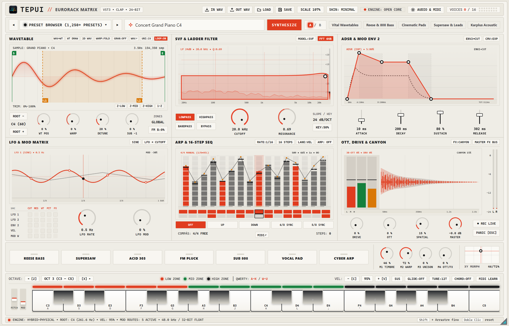 | 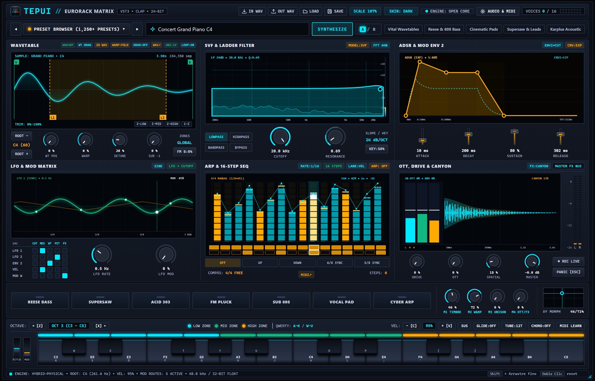 |

### Principios de Diseño Industrial (*Anti-Slop Visual Engineering*)
- **Cero Cajas Anidadas (*Zero Nested Sub-Boxes*)**: Los bancos de faders ADSR, la matriz de modulación `5×5`, los medidores VU estéreo y los selectores de modo respiran directamente sobre la superficie del módulo sin marcos interiores redundantes.
- **Contención Geométrica Estricta (`overflowCount = 0`)**: Ningún texto, perilla, fader o etiqueta desborda jamás su celda ni sufre truncamiento (`text-overflow: ellipsis` = `0`). Validado automáticamente con Chromium Headless CDP a escala Retina `2x`.
- **Primitivas `@audio-ui/react` con Anillos de Modulación en Vivo**:
  - [`Knob`](crates/plugin_vst/ui/src/components/EurorackMatrix.tsx): Perillas rotativas vectoriales con arco de valor base + arco dinámico de modulación en tiempo real (LFO 1/2, ENV 2, Matriz `5×5`, Macros `M1..M4`, Velocity y Mod Wheel).
  - [`Fader`](crates/plugin_vst/ui/src/components/EurorackMatrix.tsx): Banco táctil de 4 faders para la envolvente ADSR sincronizado bidireccionalmente con la curva interactiva.
  - [`Plot`](crates/plugin_vst/ui/src/components/EurorackMatrix.tsx) & [`Envelope`](crates/plugin_vst/ui/src/components/EurorackMatrix.tsx): Curva de respuesta en frecuencia SVF/Ladder con analizador FFT de 64 bandas post-filtro y editor ADSR de 5 puntos arrastrables.
  - [`StepSequencer`](crates/plugin_vst/ui/src/components/EurorackMatrix.tsx): Rejilla interactiva de 12/16 pasos con edición en 3 carriles (`LANE:VEL`, `LANE:RATCH`, `LANE:OCT`).
  - [`XYPad`](crates/plugin_vst/ui/src/components/PadsAndChipsDeck.tsx): Pad vectorial 2D para morphing simultáneo de `M1 TIMBRE` (X) y `M2 WARP` (Y).
  - [`Meter`](crates/plugin_vst/ui/src/components/EurorackMatrix.tsx) & [`Piano`](crates/plugin_vst/ui/src/components/TepuiKeyboardDeck.tsx): Medidores estéreo L/R con retención de picos dBFS y teclado cromático de 2 octavas con tira LED Tri-Zone (`LOW`, `MID`, `HIGH`).

---

## Arquitectura del Sistema y Flujo de Señal DSP

### 1. Arquitectura de Concurrencia Lock-Free (UI ↔ Host ↔ Hilo de Audio RT)

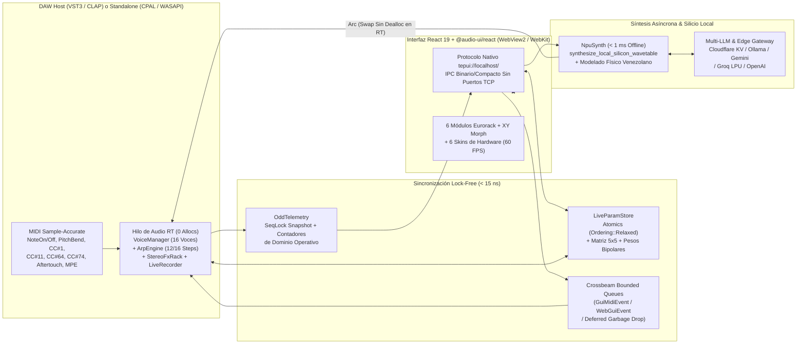

### 2. Cadena de Síntesis por Voz y Bus Maestro (`crates/synth_core/`)

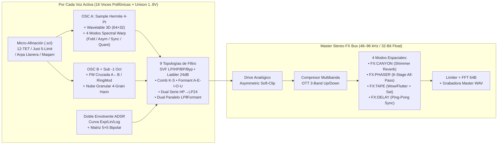

---

## Especificaciones Técnicas de Todos los Subsistemas (`v1.21.0`)

### 1. Motor de Osciladores, Wavetable 3D, Granular y Resíntesis
| Característica | Implementación en [`crates/synth_core/`](crates/synth_core/src/) |
| :--- | :--- |
| **Polifonía y Super-Unison** | 16 voces polifónicas reales con hasta **8 sub-voces de Super-Unison estéreo (`UNI:1V..8V`)**, desafinación continua (`DETUNE`) y sub-oscilador dedicado a `-1` octava (`SUB -1`). |
| **Interpolación Hermite + 2× Oversampling** | Resampling polinomial **Hermite de 4 puntos y 3er orden** con **2× Oversampling** automático en transposiciones agudas (`pitch_ratio > 1.25`) y centinelas de memoria para cero ramificaciones en el bucle interno. |
| **4 Algoritmos de Spectral Warp** | Selección en vivo desde `#btn-wt-warp-mode`: `WARP:FOLD` (Wavefolder simétrico West-Coast), `WARP:ASYM` (Curvatura de fase asimétrica), `WARP:SYNC` (Hard-Sync virtual de oscilador esclavo) y `WARP:QUANT` (Cuantización de escalera armónica). |
| **Motor Granular & Freeze (`GRAN:CLOUD` / `GRAN:FREEZE`)** | Descomposición en **4 granos superpuestos con ventana Hann** desfasados `90°`, jitter estéreo y congelación espectral estacionaria (`GRAN:FREEZE`) sin avance del cabezal. |
| **Resíntesis `WAV→WT` y Dibujo Libre `WT DRAW`** | Extracción automática de un ciclo armónico de 64 muestras con cruce por cero desde cualquier muestra cargada (`WAV→WT`), o dibujo a mano alzada sobre la pantalla OLED (`WT DRAW`). |
| **Síntesis Instantánea de Wavetables en Silicio Local (`< 1 ms`)** | [`synthesize_local_silicon_wavetable`](crates/ai_bridge/src/npu_synth.rs) genera determinísticamente un ciclo base de 64 muestras con fase alineada más una tabla morfable de 32 frames (`2048` muestras) en `< 1 ms` a partir de cualquier prompt textual (`acid`, `reese`, `choir`, `arpa`, `bell`, etc.). |

### 2. Nueve Topologías de Filtrado Por Voz ([`crates/synth_core/src/filter.rs`](crates/synth_core/src/filter.rs))
| Índice / Etiqueta UI | Topología DSP | Respuesta / Pendiente |
| :--- | :--- | :--- |
| `0..3` (`MODEL:SVF`) | **Cytomic Zero-Delay Feedback (ZDF) TPT State Variable Filter** (`Lowpass`, `Highpass`, `Bandpass`, `Bypass`) | `12/24 dB/oct` estable a cualquier cutoff y resonancia |
| `4` (`LADDER 24`) | **Moog 4-Pole Transistor Ladder Filter** con saturación no lineal `tanh` en realimentación | `24 dB/oct` cálido con auto-oscilación controlada |
| `5` (`COMB K-S`) | **Karplus-Strong Tuned Delay-Line Comb Resonator** con filtro de amortiguamiento en el lazo | Resonancia física de cuerda pulsada / tubo |
| `6` (`FORMANT`) | **3-Band Parallel Vowel Formant Resonator (`A-E-I-O-U`)** con morphing continuo según cutoff | Resonancias vocales humanas articuladas |
| `7` (`DUAL:S`) | **Doble Filtro en Serie (`DualSerialHpLp`)**: Highpass resonante de 2 polos alimentando en serie el Ladder Lowpass de 24 dB/oct | `HP → LP 24 dB/oct` quirúrgico para bajos y leads |
| `8` (`DUAL:P`) | **Doble Filtro en Paralelo (`DualParallelLpBp`)**: Cytomic SVF Lowpass sumado en paralelo con el resonador vocal Formant de 3 bandas | `LP ‖ FORMANT` con cuerpo subgrave y articulación vocal |

### 3. Micro-Afinación, Temperamentos y Escalas Scala `.scl` ([`crates/synth_core/src/voice.rs`](crates/synth_core/src/voice.rs))
- **Selector en Vivo (`#btn-tuning-mode`)**:
  - `0 = TUNE:12T`: Temperamento igual estándar de 12 semitonos (`12-TET`).
  - `1 = TUNE:JUST`: **Just Intonation (5-Limit)** con terceras mayores/menores y quintas puras libres de batimiento.
  - `2 = TUNE:HARP`: **Temperamento de Arpa Llanera Venezolana**, con terceras brillantes y sextas resonantes propias del bordoneo criollo.
  - `3 = TUNE:MAQAM`: **Escala Microtonal de Cuarto de Tono (`Maqam Rast / Bayati`)** con grados rebajados en `-50 cents`.
  - `4 = Custom Scala (.scl)`: Parser nativo [`parse_scala_scl_cents`](crates/synth_core/src/voice.rs) compatible con el formato estándar de archivos `.scl` (definiciones en cents como `701.955` o razones enteras como `3/2`, `5/4`).

### 4. Expresión en Vivo, Armonizador de Acordes, Arpegiador 16-Step y Exportación MIDI `.mid`
- **Armonizador Polifónico y Rasgueo (`#btn-chord-mode`)**:
  - `CHORD:OFF` (Nota individual), `CHORD:MIN7` (`[0, +3, +7, +10]` semitonos), `CHORD:MAJ9` (`[0, +4, +7, +11, +14]`) y `CHORD:STRUM` (voicing abierto de Cuatro/Arpa `[0, +4, +7, +14]` con escalonamiento dinámico de velocidad).
- **Portamento Exponencial, Legato Single-Trigger y MPE (`#btn-glide-legato`)**:
  - Deslizamiento exponencial libre de clicks (`OFF`, `PORTA 85ms`, `LEGATO 140ms` sin re-disparar el ataque ADSR en notas ligadas) y soporte MPE por nota.
- **Matriz de Modulación `5×5` con Atenuversores Bipolares (`-100%..+100%`)**:
  - 5 fuentes (`LFO 1`, `LFO 2`, `ENV 2`, `VEL`, `MOD W`) × 5 destinos (`CUT`, `RES`, `WT`, `PIT`, `FX`).
  - **Clic normal**: Activa/desactiva el pin de enrutamiento.
  - **`Shift + Clic`**: Cicla el peso bipolar independiente de esa celda (`+100%`, `-75%`, `+50%`, `-50%`) en tiempo real (`moddepth,<cell>,<weight>`).
- **Arpegiador Polifónico y Secuenciador de 12/16 Pasos (`#mod-arp`)**:
  - Modos `OFF`, `UP`, `DOWN`, **Joropo Llanero (`6/8 SYNC`)** y **Merengue Venezolano (`5/8 SYNC`)**.
  - Divisiones rítmicas sincronizadas al DAW (`1/4`, `1/8`, `1/16`, `1/8T` tresillo, `1/16D` puntillo).
  - 3 carriles editables por paso: **Velocity (`5%..100%`)**, **Ratchet Sub-Repeats (`1x..4x`)** y **Octave Transpose (`-1..+1`)**.
  - **Exportación Directa de Clips MIDI (`.mid` SMF Format 0 — `#btn-arp-midi` / `MIDI↗`)**: Codifica al instante el patrón activo (velocidades, octavas y subdivisiones Ratchet) como archivo binario Standard MIDI File `.mid` de `480 PPQ` listo para arrastrar o importar en cualquier DAW.

### 5. Master Stereo FX Bus (`4 Modos`) y Grabadora Master WAV
- **Selector de Bus Espacial (`#btn-fx-bus-mode`)**:
  1. `FX:CANYON`: Reverberación algorítmica *Tepui Canyon Shimmer* con red de retardos difusos estéreo.
  2. `FX:PHASER`: Phaser analógico estéreo de 6 etapas all-pass con barrido LFO en cuadratura.
  3. `FX:TAPE`: Emulación de cinta magnética con modulación orgánica *Wow & Flutter*, saturación de cabezal y roll-off cálido de agudos.
  4. `FX:DELAY`: **Delay Estéreo Ping-Pong Sincronizado al Tempo del Host** con realimentación cruzada L↔R y filtrado en el lazo.
- **Compresor Multibanda OTT + Drive + Grabadora Master (`#btn-live-rec`)**:
  - Compresión ascendente/descendente de 3 bandas estilo OTT, distorsión armónica `DRIVE` y grabación en vivo post-FX a archivo `.wav` IEEE Float de 32 bits sin bloquear el hilo de audio.

---

## Plantilla Open-Source: Cómo Crear tu Propio VST3 / CLAP con este Stack

Este repositorio está estructurado para que puedas hacer **Fork / Use as Template** y construir tu propio sintetizador, sampler o procesador de efectos manteniendo las garantías de tiempo real y la calidad visual.

### Mapa de Responsabilidades del Workspace

```text
tepui-vst/
├── crates/
│   ├── synth_core/                  # 1. MOTOR DSP PURO (Sin dependencias de UI ni de red)
│   │   └── src/
│   │       ├── lib.rs               # Buffers de muestras, resampler Hermite, exportador WAV/Base64
│   │       ├── voice.rs             # Voz individual: Osc A/B, Unison, Warp, Granular, Micro-Tuning .scl
│   │       ├── voice_manager.rs     # Polifonía de 16 voces, Matriz 5x5 bipolar, LFO, MPE, Keyzones
│   │       ├── filter.rs            # 9 topologías: Cytomic SVF ZDF, Ladder 24dB, Comb, Formant, Dual S/P
│   │       ├── envelope.rs          # Envolventes ADSR con tensión de curva Exp/Lin/Log y modo Legato
│   │       ├── arp.rs               # Arpegiador 6/8 y 5/8, 16-Step Ratchet/Octave y codificador SMF .mid
│   │       └── fx.rs                # Master FX Bus: Drive, OTT 3-Band, Canyon, Phaser, Tape, Ping-Pong Delay
│   │
│   ├── ai_bridge/                   # 2. SÍNTESIS ASÍNCRONA, MODELADO FÍSICO Y SILICIO LOCAL
│   │   └── src/
│   │       ├── lib.rs               # AiWorker en hilo de fondo, caché NPU y pasarela Cloud/BYOK
│   │       ├── npu_synth.rs         # Modelado físico + synthesize_local_silicon_wavetable (< 1 ms)
│   │       ├── folklore_presets.rs  # Catálogo paramétrico de 1,250+ presets de fábrica
│   │       └── preset_schema.rs     # Esquema JSON validado y normalización Piano-Roll (YIN + Onset Trim)
│   │
│   ├── plugin_vst/                  # 3. SHELL DEL PLUGIN (NIH-PLUG VST3/CLAP), HOST STANDALONE Y UI REACT
│   │   ├── src/
│   │   │   ├── lib.rs               # Punto de entrada NIH-plug (process(), VST3_CLASS_ID, CLAP_ID)
│   │   │   ├── params.rs            # LiveParamStore (Atomics), ParameterSmoother, OddTelemetry (SeqLock)
│   │   │   ├── web_editor.rs        # Puente WebView2/WebKit, protocolo tepui://localhost/ y router IPC
│   │   │   ├── ui_dsp_contract.rs   # Las 7 Compuertas de Certificación UI↔DSP (Tests de contrato)
│   │   │   ├── audio_devices.rs     # Enumeración CPAL/WASAPI y Hot-Plug MIDI para modo Standalone
│   │   │   └── bin/tepui_studio.rs  # Ejecutable Standalone de baja latencia
│   │   └── ui/                      # Aplicación Frontend React 19 + TypeScript + @audio-ui/react
│   │       ├── src/components/      # TopHeader, CommandDock, EurorackMatrix, PadsAndChipsDeck, KeyboardDeck
│   │       ├── src/engine/          # Motor de renderizado OLED 60 FPS y sincronización IPC
│   │       ├── src/state/           # Store reactivo sin bloqueos (useSyncExternalStore)
│   │       ├── style.css            # Sistema de diseño Flush Architectural Grid + 6 Hardware Skins
│   │       └── build.mjs            # Empaquetador esbuild ultrarrápido -> app.js embebido en el binario Rust
│   │
│   └── xtask/                       # 4. AUTOMATIZACIÓN DE BUNDLES, INSTALADOR SFX Y VERSIONADO
│       └── src/main.rs              # Empaquetador VST3/CLAP y creador de TEPUI-Setup-Windows-x64.exe
│
├── installer/
│   └── sign_binaries.ps1            # Firma digital Windows Authenticode SHA-256 + RFC3161 Timestamp
├── cloudflare/                      # Edge Worker opcional (KV Cache comunitario + Checkout HMAC-SHA256)
└── site/                            # Landing page estática de alta conversión con preview de video
```

### Guía Paso a Paso para Personalizar tu Propio Plugin

#### Paso 1: Cambiar la Identidad del Plugin con el Generador Automático (`xtask init-template`)
Ejecuta el generador incluido en [`crates/xtask/src/main.rs`](crates/xtask/src/main.rs) para derivar automáticamente un `CLAP_ID` y un `VST3_CLASS_ID` de 16 bytes libre de colisiones:
```powershell
cargo run --package xtask -- init-template --name "MiSintetizador" --vendor "MiEstudioAudio" --id "com.miestudioaudio.misintetizador"
```
Luego pega las constantes generadas en [`crates/plugin_vst/src/lib.rs`](crates/plugin_vst/src/lib.rs) (`NAME`, `VENDOR`, `CLAP_ID` y `VST3_CLASS_ID`).

#### Paso 2: Añadir un Nuevo Parámetro DSP Lock-Free
1. **En [`crates/synth_core/`](crates/synth_core/src/)**: Implementa el algoritmo DSP en [`filter.rs`](crates/synth_core/src/filter.rs), [`voice.rs`](crates/synth_core/src/voice.rs) o [`fx.rs`](crates/synth_core/src/fx.rs) sin usar `Vec::push`, `Box::new` ni `Mutex::lock` dentro del bloque de audio.
2. **En [`crates/plugin_vst/src/params.rs`](crates/plugin_vst/src/params.rs)**:
   - Añade el campo atómico (`AtomicU32` para `f32::to_bits` o `AtomicI32` para modos discretos) en [`LiveParamStore`](crates/plugin_vst/src/params.rs).
   - Proyéctalo hacia `VoiceManager` o `StereoFxRack` dentro de [`LiveParamStore::project_to_dsp`](crates/plugin_vst/src/params.rs) (que se ejecuta una vez al inicio de cada bloque de audio en `< 15 ns`).
3. **En [`crates/plugin_vst/src/web_editor.rs`](crates/plugin_vst/src/web_editor.rs)**: Añade el prefijo IPC compacto en `handle_native_ipc_message` para que la UI pueda mutar el parámetro instantáneamente.

#### Paso 3: Añadir un Control Visual con `@audio-ui/react`
1. **En [`crates/plugin_vst/ui/src/components/`](crates/plugin_vst/ui/src/components/)**: Usa los wrappers [`TepuiKnob`](crates/plugin_vst/ui/src/components/EurorackMatrix.tsx), [`TepuiFader`](crates/plugin_vst/ui/src/components/EurorackMatrix.tsx), `Plot`, `Envelope`, `XYPad` o añade un botón con `id="btn-mi-control"`.
2. **Compila el bundle frontend** (se incrusta automáticamente en el binario Rust mediante `include_str!`):
   ```powershell
   Set-Location crates\plugin_vst\ui
   npm run typecheck
   npm run build
   ```

#### Paso 4: Registrar el Control en las 7 Compuertas de Certificación (`ui_dsp_contract.rs`)
En [`crates/plugin_vst/src/ui_dsp_contract.rs`](crates/plugin_vst/src/ui_dsp_contract.rs), registra el nuevo ID en el enum exhaustivo `SynthControlId` y su prefijo IPC en `CANONICAL_IPC_PREFIXES`. Si olvidas conectar un botón de la UI al motor de audio, **los tests fallarán en compilación o ejecución** impidiendo que existan controles decorativos ("botones fantasma").

---

## Las 7 Compuertas de Certificación UI↔DSP ([`ui_dsp_contract.rs`](crates/plugin_vst/src/ui_dsp_contract.rs))

Una de las mayores fortalezas de este repositorio como plantilla es su arquitectura de verificación en [`crates/plugin_vst/src/ui_dsp_contract.rs`](crates/plugin_vst/src/ui_dsp_contract.rs):

| Compuerta | Test Automatizado | Qué Garantiza Matemáticamente |
| :--- | :--- | :--- |
| **Gate 1 — Cobertura Exhaustiva del DOM** | `test_gate_1_exhaustive_html_dom_coverage_no_unregistered_buttons_knobs_or_oleds` | Escanea `index.html` y verifica que **todo** `<button id="...">`, `[data-param="..."]` y `<canvas id="...">` esté tipado en `SynthControlId::ALL`. Cero controles huérfanos. |
| **Gate 2 — Contrato Bidireccional IPC (JS → Rust)** | `test_gate_2_bidirectional_js_to_rust_ipc_prefix_contract` | Escanea el bundle compilado `app.js`, extrae cada invocación `sendIpc(...)` y certifica que sea parseada sin error por `IpcCommand::parse`. |
| **Gate 3 — Impacto Real en el Motor DSP** | `test_gate_3_exhaustive_dsp_engine_impact_for_all_synth_controls` | Dispara cada comando de la UI y procesa bloques reales de audio en `VoiceManager` y `StereoFxRack`, verificando diferencias medibles de RMS, fase o espectro en la señal de salida. |
| **Gate 4 — Persistencia de Sesión DAW y `.tepui`** | `test_gate_4_full_daw_session_and_tepui_patch_persistence_plus_legacy_backcompat` | Verifica el roundtrip completo de estado del proyecto DAW y archivos `.tepui`, incluyendo retrocompatibilidad con patches de versiones anteriores. |
| **Gate 5 — Patrones de Tiempo Real (0-Alloc)** | `test_gate_5_architectural_patterns_projector_snapshot_smoother_seqlock` | Verifica `LiveParamStore::project_to_dsp`, suavizado exponencial libre de zipper noise (`ParameterSmoother`) y lectura consistente sin bloqueos (`OddTelemetry` SeqLock). |
| **Gate 6 & 7 — Sistema de 6 Skins y Default** | `test_gate_6_and_7_skin_minimal_default_and_skin_selector_contract` | Certifica que `Swiss Daylight Lab (skin-minimal)` sea el tema por defecto y que las 6 skins de hardware existan tanto en el DOM como en la hoja de estilos. |

---

## Compilación, Pruebas y Empaquetado Local

### Requisitos Previos
- **Rust Stable** (`>= 1.80`, edición 2021).
- **Node.js** (`>= 20`) únicamente si deseas modificar y recompilar el código TypeScript/React en `crates/plugin_vst/ui/` (el archivo `app.js` compilado ya está incluido en el repositorio para que `cargo build` funcione directamente sin requerir Node).
- **Dependencias del Sistema Operativo**:
  - **Windows 10/11 (x64)**: Toolchain MSVC (`x86_64-pc-windows-msvc`) y Microsoft Edge WebView2 Runtime (incluido por defecto en Windows 10/11).
  - **macOS**: Xcode Command Line Tools (`xcode-select --install`).
  - **Linux (Ubuntu/Debian x64)**: `libasound2-dev libjack-jackd2-dev libwebkit2gtk-4.1-dev libgtk-3-dev libx11-dev libx11-xcb-dev libxcb1-dev libxcursor-dev libxrandr-dev libxi-dev pkg-config`.

### 1. Ejecutar Linter Estricto y las 85 Pruebas Automatizadas
```powershell
cargo clippy --workspace --all-targets --no-deps -- -D warnings
cargo test --workspace --release
```

### 2. Recompilar la Interfaz React + `@audio-ui/react` (Opcional tras editar `ui/src/`)
```powershell
Push-Location crates\plugin_vst\ui
npm install
npm run typecheck
npm run build
Pop-Location
```

### 3. Compilar e Instalar Bundles Release (`VST3`, `CLAP`, `Standalone` e Instalador `SFX`)
```powershell
cargo build --release -p plugin_vst --bins
cargo run --package xtask -- bundle plugin_vst --release
cargo run --package xtask -- install
```

El comando `cargo run --package xtask -- install` genera e instala automáticamente:
- **Plugin VST3**: `C:\Program Files\Common Files\VST3\TEPUI.vst3` (con fallback automático sin requerir permisos de Administrador en `%LOCALAPPDATA%\Programs\Common\VST3\TEPUI.vst3`).
- **Plugin CLAP**: `C:\Program Files\Common Files\CLAP\TEPUI.clap` (fallback en `%LOCALAPPDATA%\Programs\Common\CLAP\TEPUI.clap`).
- **Workstation Standalone**: `%LOCALAPPDATA%\Programs\Tepui\tepui_studio.exe`.
- **Instalador Auto-Extraíble de Distribución**: `target/bundled/TEPUI-Setup-Windows-x64.exe`.

### 4. Firma Digital Windows Authenticode (Opcional para Distribución Comercial)
El script [`installer/sign_binaries.ps1`](installer/sign_binaries.ps1) firma automáticamente `TEPUI.vst3`, `TEPUI.clap`, `tepui_studio.exe` y `TEPUI-Setup-Windows-x64.exe` con SHA-256 y sello de tiempo RFC3161 (`http://timestamp.digicert.com`) cuando las variables `WINDOWS_CERT_PFX_BASE64` y `WINDOWS_CERT_PASSWORD` están definidas en el entorno o en GitHub Secrets (y opera como *no-op* limpio cuando no están configuradas). Además, el desempacador SFX en [`crates/xtask/src/main.rs`](crates/xtask/src/main.rs) es resiliente a bloques PKCS#7 anexados por `signtool.exe`.

---

## CI/CD, Certificación `clap-validator` y Semantic Release

Cada push o Pull Request hacia `main` ejecuta automáticamente:
1. **[`.github/workflows/ci.yml`](.github/workflows/ci.yml)**: Compila y ejecuta los 85 tests en **Windows x64**, **macOS** y **Linux x64**, empaqueta los bundles `TEPUI.vst3` y `TEPUI.clap`, y ejecuta la herramienta oficial **[`clap-validator`](https://github.com/free-audio/clap-validator)** verificando `0 failed` en las pruebas de concurrencia, parámetros y estado del estándar CLAP.
2. **[`.github/workflows/release.yml`](.github/workflows/release.yml)**: Analiza los commits siguiendo [Conventional Commits](https://www.conventionalcommits.org/), incrementa la versión semántica en todos los `Cargo.toml`, actualiza [`CHANGELOG.md`](CHANGELOG.md), firma los binarios si hay certificado configurado y publica los paquetes de Windows, macOS y Linux en GitHub Releases.

---

## Modelo de Sostenibilidad Open-Source Honesto (Cero Taxímetros ni DRM Artificial)

En un proyecto Open-Source, intentar cobrar micro-créditos por clic o depender de DRM local carece de sentido técnico (cualquiera puede recompilar el binario o conectar su propia API key) y deteriora la experiencia del músico. Por ello, **TEPUI** sigue el modelo de sostenibilidad transparente de proyectos referentes como *Vital*, *Ardour*, *VCV Rack* y *Blender*:

| Nivel / Vía | Qué Incluye | Precio |
| :--- | :--- | :--- |
| **1. Community Open-Source (`MIT`)** | Motor DSP completo de 16 voces, las 6 skins de hardware, 1,250+ presets paramétricos, síntesis en silicio local (`< 1 ms`), conexión libre a Ollama/Gemini/Groq/OpenAI y código fuente íntegro sin ningún límite ni contador artificial. | **`$0 USD` (Gratis para siempre)** |
| **2. Producer Sound Packs &amp; Supporter Pass** | Expansiones oficiales `.tepui` grabadas en estudio con micrófonos de condensador, bancos de Wavetables de autor, instaladores oficiales firmados 1-clic y apoyo directo al desarrollo independiente. | **`$19 USD` (Pago único)** |
| **3. Commercial Plugin Template SDK (`B2B`)** | Licencia comercial white-label (sin obligación de atribución en la UI), generador `cargo xtask init-template` y soporte de arquitectura para marcas y estudios que lancen plugins comerciales de código cerrado basados en este stack. | **`$199 USD` (Por estudio)** |

---

## Licencia

Distribuido bajo la licencia Open-Source **MIT**. Consulta el archivo [`LICENSE`](LICENSE) para más detalles. Eres libre de utilizar **TEPUI** en tus producciones musicales o de emplear su arquitectura como plantilla para crear tus propios instrumentos y efectos VST3 / CLAP / Standalone.
